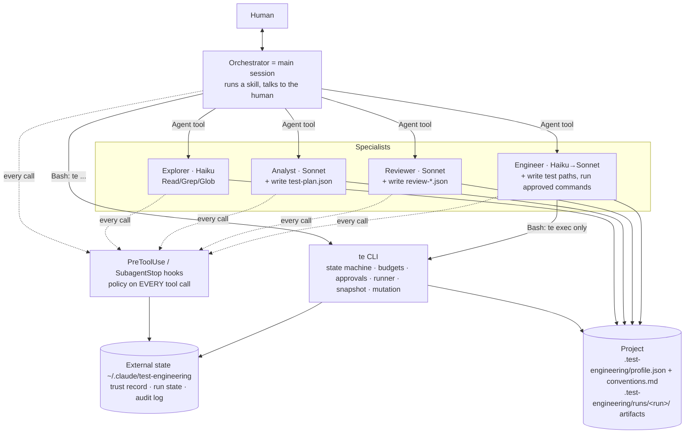
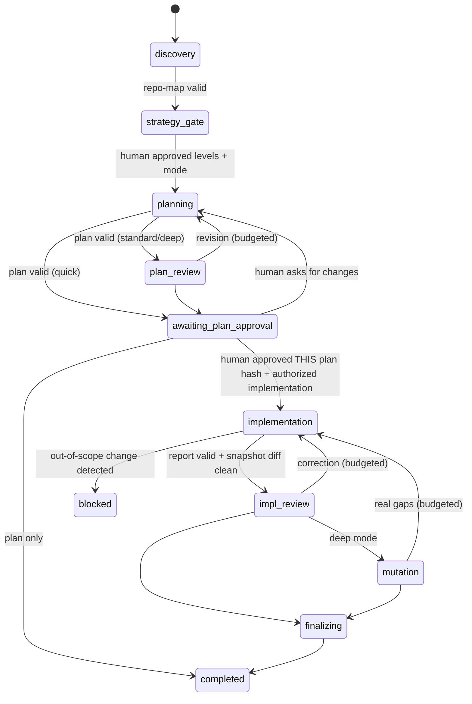

# Agentic Test Engineering System — Architecture (as implemented)

**Status:** implemented as a Claude Code plugin (`plugin/`), policy version `1`.
**Supersedes:** the platform-neutral reference design in `test-engineering-agent-architecture/` (kept unchanged as the input brief). Where the two differ, this document and `SECURITY_MODEL.md` are authoritative; every difference is listed in §9 with its reason.

## 1. What it is

A workflow-led, specialist-assisted system that plans, implements and independently reviews automated tests for any repository, in any language. It optimises for *defensible tests at the cheapest sufficient level*, not for test count or coverage.

- **One orchestrator** — the main Claude Code session, driven by a skill.
- **Three skills** — `test-setup`, `test-plan`, `implement-tests`.
- **Four specialists** — explorer, analyst, reviewer, engineer; each with a narrow tool set.
- **One deterministic core** — a standard-library Python CLI (`te`) and hook policy. All state, budgets, approvals, command execution and evidence live there, not in a model's memory.

## 2. Components and where they live

| Logical component | Native implementation | Path |
|---|---|---|
| Orchestrator | Main session following a skill; constrained by hooks while a run is current | — |
| Skills (workflows) | Plugin skills | `plugin/skills/{test-setup,test-plan,implement-tests}/SKILL.md` |
| Specialist agents | Plugin subagents with `tools` allowlists and pinned models | `plugin/agents/*.md` |
| Policy enforcement layer | `PreToolUse` hook (exec form, no shell, `onFailure: block`) | `plugin/hooks/hooks.json`, `plugin/scripts/hook.py`, `telib/policy.py` |
| Structured-output validation | `SubagentStop` hook + `te validate` | `telib/policy.py`, `telib/artifacts.py` |
| Workflow state, budgets, gates | Deterministic state machine | `telib/workflow.py`, `telib/state.py` |
| Constrained test runner | `te exec` — approved argv arrays, no shell | `telib/runner.py` |
| Project memory | Approved profile + conventions | `<project>/.test-engineering/` |
| Scope check | File-tree snapshot diff | `telib/snapshot.py` |
| Mutation check (deep mode) | Scripted operators in a disposable copy | `telib/mutation.py` |
| Audit | Append-only JSONL outside the repository | `~/.claude/test-engineering/projects/<id>/audit.jsonl` |
| Templates/contracts | JSON schemas in code, Markdown rendering | `telib/artifacts.py` |

## 3. Project memory: learn once, reuse

`test-setup` runs once per repository (and again only when needed). It produces:

- **`.test-engineering/profile.json`** — machine-readable and the **only** source of execution permissions: stacks and versions, test frameworks and config files, commands as argv arrays (each `verified` or not), test layout per level, `allowed_write_paths`, `excluded_paths`, `secret_paths`/`secret_files`, configuration `fingerprints`, `profile_version`, `generated_at`, `last_verified_at`.
- **`.test-engineering/conventions.md`** — human-readable conventions (fixtures, factories, mocking, naming). Read by the agents, owned by the team.

Rules:

- **Refresh by fingerprint, not by run.** `te run init` refuses to start a plan when a fingerprinted config file changed, until the profile is refreshed or the human accepts the drift.
- **Never overwrite manual edits silently.** The plugin remembers the hash of what it last wrote; a proposal always goes to `profile.proposed.json`, the diff is shown, and manual edits are called out. `conventions.md` with manual edits is never replaced; the new text stays in `conventions.proposed.md`.
- **Trust is explicit.** The profile is repository content, so it is untrusted until a human approves its exact hash on this machine (see `SECURITY_MODEL.md` §3). Unapproved or modified profile ⇒ every workflow is blocked.
- **Verified vs unverified commands.** Only the CLI can mark a command verified, and only by actually running it. Specialists cannot run unverified commands.

Detection is language-agnostic: `te detect` reads manifests (Python, Node/TypeScript, Rust, Go, Java/Kotlin, .NET, Ruby, PHP) and existing test files to produce *hints*; the explorer confirms or corrects them from evidence; an unknown stack is reported as unknown rather than forced into a known shape.

## 4. Workflows

### 4.1 Phases (enforced by `te phase`, not by prose)

Each role can be spawned, and can act, only in its phases: explorer → `discovery`; analyst → `planning`; reviewer → `plan_review`, `impl_review`, `mutation`; engineer → `implementation`.

### 4.2 Human checkpoints

| Gate | When | Mechanism |
|---|---|---|
| Profile approval | setup / refresh / after a pulled change | `te profile approve` → permission prompt |
| **Strategy gate** | after discovery, before any expensive analysis | AskUserQuestion: test levels (with the reason for each), mode, rough size |
| Plan approval | before any implementation | `te plan approve [--authorize-implementation]` → permission prompt; bound to the plan hash |
| Scope expansion | engineer needs one file outside test paths | `te scope approve --path <exact file>` → permission prompt; this run only |
| Unblock | a scope violation was detected | `te run unblock` → permission prompt |
| Final acceptance | always | Final report; the system never claims acceptance |

Everything else is automatic. Approvals that raise a permission prompt are denied outright when the session runs in a prompt-bypassing permission mode.

### 4.3 Choosing the test level (cost rule)

Lowest level at which the behaviour is observable without mocking away the thing under test. Unit for pure logic; integration/API where the behaviour only exists in the interaction with a real framework/DB/HTTP layer; end-to-end only for a critical journey that cannot be observed lower **and** only when e2e infrastructure already exists — otherwise it is recorded as a coverage gap, not written. The human confirms the level set at the strategy gate; the plan validator rejects cases at unapproved levels; the reviewer has a dedicated `test_level` finding type for over- or under-levelled cases.

### 4.4 Modes

| Mode | Plan review | Plan revision cycles | Impl. correction cycles | Mutation check | Levels |
|---|---|---:|---:|---|---|
| `quick` | no | 0 | 1 | no | unit only |
| `standard` (default) | yes | 1 | 1 | no | as approved |
| `deep` | yes | 2 | 2 | yes (P0/P1) | as approved |

### 4.5 Models (cost policy)

| Role | Default | Notes |
|---|---|---|
| Orchestrator | the session model | Skills cannot pin the session model; use `/model sonnet` for cost. |
| Explorer | Haiku | locating and reading |
| Analyst | Sonnet | plan quality is where test quality is decided |
| Reviewer | Sonnet | independent judgement |
| Engineer | Haiku | first pass and a correction with ≤ medium findings |
| Engineer (escalated) | Sonnet | correction with a high/critical finding, and always the 2nd correction |

Overridable per project in `.test-engineering/config.json` (`models`, `default_mode` only — never budgets or permissions). `te run status` prints the model to use for the next engineer spawn.

## 5. Artifacts and contracts

All handoffs are JSON files in `.test-engineering/runs/<run-id>/`, validated by schema **and** cross-artifact checks:

| Artifact | Written by | Notable checks |
|---|---|---|
| `repo-map.json` / `profile-draft.json` | explorer (persisted by the hook — the explorer has no write tool) | schema; draft profile validated as a real profile |
| `test-plan.json` → `test-plan.md` | analyst | unique `TC-nnn` ids; P0/P1 cases reference a requirement/risk; every requirement covered or declared a gap; levels within the approved set |
| `review-plan.json`, `review-impl.json` | reviewer | verdict cannot be `APPROVE` with critical/high findings |
| `impl-report.json` | engineer | every planned case mapped; plan hash matches; every cited result id is a **recorded** execution |
| `results/NNN.json` + `.log` | `te exec` | mechanical evidence: argv, exit code, duration, outcome, flaky flag |
| `changes.json`, `diff.patch` | `te phase impl_review` | snapshot diff; no git required |
| `mutation-report.json` | `te mutate` | killed / survived / unviable / not_run |
| `final-report.md` | `te report` | assembled from recorded evidence and the audit log |

Evidence produced by the CLI cannot be written by any agent or by the orchestrator.

## 6. Reliability

| Loop | Limit | Enforced by |
|---|---:|---|
| Transient re-spawn of a specialist | 2 per run in total | `PreToolUse` on the Agent tool (spawn counter) |
| Invalid artifact repair | 1 per agent | `SubagentStop` hook with an external counter |
| Plan revision cycles | per mode | `te phase` guard |
| Implementation correction cycles | per mode | `te phase` guard |
| Flaky diagnostic rerun | 1 per result | `te exec --rerun-of` |
| Command executions | 40 per run | `te exec` |
| Runner launch failure | 2 retries, exponential backoff with jitter (1 s base, 10 s cap) | `telib/runner.py` |
| Nested delegation | none | specialists have no Agent tool; hook denies spawns from subagents |

Failure classes and responses: policy denial and permanent configuration errors are never retried; a failing assertion is never rerun to get green; inconsistent outcomes are recorded as `flaky` on both results; an out-of-scope change blocks the run until a human decides; when a budget is exhausted the workflow stops with artifacts preserved and a precise escalation.

## 7. Mutation check (deep mode)

The model never edits production code. The reviewer *proposes* `(file, line, operator)` from a fixed catalog (`rel_boundary`, `eq_negate`, `const_shift`, `remove_null_check`, `negate_condition`, `bool_flip`, `remove_line`). `te mutate` validates each, copies the project to a temp directory, runs a baseline (tests must pass) and a canary (a deliberately broken target file must make tests fail — otherwise the tests are not exercising the copy and the result is `environment_invalid`, not `survived`), applies one mutation at a time, runs the selected tests, and deletes the copy. It compares the original tree before and after.

`killed` includes compile-time failures; `survived` is a potential coverage gap, not a proven defect; `equivalent` is a reviewer judgement, never produced by the script.

## 8. Observability

Every hook decision for a specialist (allow and deny) and every decision that constrains the orchestrator is appended to the audit log with timestamp, session, agent type, role, tool, target, decision, reason, run and phase. File contents are not logged. `te report` summarises decisions and lists denials per run; `te audit tail` shows the raw log.

## 9. Differences from the reference design, and why

| # | Reference design | Implemented | Reason |
|---|---|---|---|
| 1 | Two skills | Three: added `test-setup` | Project memory was missing; rediscovering the repository every run is the main avoidable cost. |
| 2 | "Inherit model" | Per-role model policy with escalation by cycle | Cost requirement. |
| 3 | Analyst alone picks test levels | Human strategy gate + validator + reviewer check | Avoid paying for unnecessary e2e/integration tests. |
| 4 | One depth | `quick` / `standard` / `deep` | A one-line change does not need the full cycle. |
| 5 | Explorer has `artifact.write` | Explorer has no write tool; the hook persists its output | Strict least privilege (approved table: Explorer = read only). |
| 6 | Reviewer must judge "would fail on regression" but nobody can check | Scripted mutation check in a disposable copy | Otherwise the criterion is unverifiable; models must not edit production code. |
| 7 | Explorer discovers "exact commands" but cannot run anything | Commands are `unverified` until the CLI runs them | Separates discovery from evidence. |
| 8 | Orchestrator "has no source-write capability" | Orchestrator lock: while a run is current, the session cannot edit project files or run non-`te` shell commands | The main session cannot be given a reduced tool set natively; hooks provide the restriction. |
| 9 | Backoff with jitter for all transient failures | Only for runner launch failures | API/network retries belong to the harness; nothing else in this workflow has a network path. |
| 10 | Token/cost budgets | Spawn, cycle and execution counters | Claude Code exposes no per-run token budget to hooks. Counters bound cost deterministically. |
| 11 | Tool gateway / per-agent hooks | One central `hooks.json` branching on `agent_type` | Hooks in plugin agent frontmatter are ignored by Claude Code; central policy is also easier to audit. |
| 12 | Artifacts "outside the source tree" | Artifacts in `.test-engineering/runs/` (git-ignored); trust, counters and audit outside the repository | Humans need to read plans next to the code; what must be tamper-resistant is kept out of reach. |
| 13 | Profile-less | Profile trust bound to hash + project path + policy version | Without it, a file in the repository would control the security policy. |

**Process note.** The request was to update the architecture documentation before implementing. The approved decisions were fixed first (two question rounds), but this document was written alongside the code rather than strictly before it, so that it describes what was actually verified.
