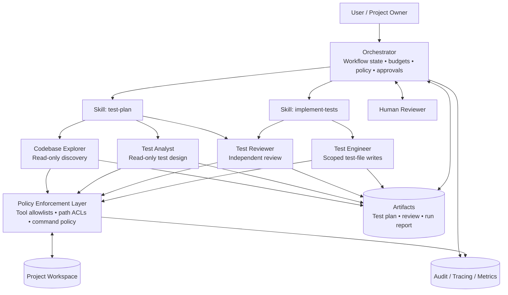
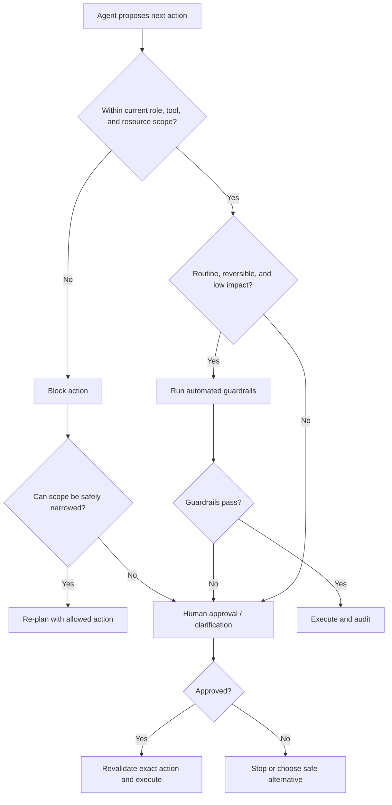

# Agentic Test Engineering System — Architecture

## 1. Executive summary

This architecture defines a quality-first, multi-agent workflow for planning, implementing, and reviewing automated tests in an existing software project.

The system is intentionally **workflow-led and specialist-assisted**, not a swarm of autonomous agents. A single Orchestrator owns task state and transitions. Skills define the repeatable process. Specialist agents perform bounded units of work and return structured artifacts. A separate policy layer controls which tools and resources each agent can access.

The target outcome is not maximum test count or line coverage. It is a defensible set of tests that trace back to requirements, exercise important boundaries and failure modes, make meaningful assertions, and remain deterministic and maintainable.

### Core design decisions

1. One Orchestrator; no nested orchestrator hierarchy in the initial system.
2. Two workflows: `test-plan` and `implement-tests`.
3. Four specialists with non-overlapping responsibilities.
4. Default-deny tool access, narrowed by role and resource scope.
5. Independent review at both planning and implementation stages.
6. Bounded retries and review loops, with explicit stop conditions.
7. Human approval for ambiguous, high-impact, irreversible, or out-of-scope decisions—not for every routine step.
8. Evidence-based expected results. The current implementation is evidence, but is not automatically the specification.
9. Runtime-enforced isolation. Prompt instructions alone do not provide security.
10. Every run produces an auditable summary of decisions, tools, tests, unresolved risks, and approvals.

## 2. Goals and non-goals

### Goals

- Discover the actual project structure, architecture, language, test framework, conventions, and test commands before proposing tests.
- Convert requirements, contracts, acceptance criteria, and domain invariants into traceable test conditions and cases.
- Systematically consider positive, negative, boundary, equivalence-class, state-transition, interaction, concurrency, recovery, and relevant non-functional scenarios.
- Independently challenge the test plan and the implemented tests.
- Implement tests using project conventions and the smallest sensible testing layer.
- Prevent scope creep into production behavior, dependencies, CI, migrations, credentials, or shared infrastructure.
- Detect uncertainty and escalate decisions that cannot safely be inferred.
- Keep costs and execution bounded through budgets, checkpoints, and targeted delegation.

### Non-goals

- Replacing human ownership of requirements, release decisions, or production risk acceptance.
- Guaranteeing that all defects are found.
- Maximizing test count, line coverage, or mutation score without regard to value.
- Automatically modifying production code to make generated tests pass.
- Installing dependencies, changing build pipelines, altering schemas, deploying, committing, or pushing changes by default.
- Running unbounded autonomous agent loops.

## 3. Conceptual model

### 3.1 Orchestrator

The Orchestrator is the primary agent/session or a deterministic workflow controller around the agents. It:

- interprets the user's request and determines whether planning, implementation, or both are authorized;
- selects and invokes the appropriate Skill;
- maintains the run state, artifacts, trace identifiers, iteration counters, and budgets;
- delegates work to the specialists with bounded inputs and explicit output contracts;
- validates outputs before accepting them;
- enforces phase transitions, tool policies, retry limits, and approval gates;
- resolves conflicting findings or asks for human input;
- inspects the final diff and produces the final report.

The Orchestrator should not perform specialist work redundantly. Its job is coordination, policy enforcement, synthesis, and decisions.

### 3.2 Skills

A Skill is a reusable workflow definition, not a separate autonomous authority. It describes:

- when the workflow should be used;
- required inputs and prerequisites;
- ordered steps and delegation rules;
- expected intermediate artifacts;
- quality gates and stop conditions;
- how to handle failure, uncertainty, and human review.

Skills do not grant permissions by themselves. The runtime or tool policy determines which capabilities are actually available.

### 3.3 Specialist agents

| Agent | Primary responsibility | Mutates project files? | Main output |
|---|---|---:|---|
| `test-codebase-explorer` | Discover implementation, contracts, test infrastructure, and conventions | No | Repository/test-environment map with evidence |
| `test-analyst` | Derive risk-based test conditions and cases from evidence | No | Traceable test plan and open questions |
| `test-reviewer` | Independently identify omissions and weak assertions | No | Prioritized review findings |
| `test-engineer` | Implement approved tests and run scoped verification | Yes, within approved test paths only | Test changes and execution report |

No specialist should delegate to another specialist in the initial design. The Orchestrator owns delegation. This keeps control flow visible and avoids hidden recursive delegation.

## 4. System architecture



**Interpretation:** The policy enforcement layer sits between every agent and its tools/resources. It is not optional decoration. It must enforce the permission matrix at execution time. Artifacts are explicit handoff objects; they are not unrestricted shared memory.

### 4.1 Trust boundaries

Treat each of the following as an untrusted or separately validated boundary:

- repository files, comments, test fixtures, generated files, and documentation;
- issue descriptions, acceptance criteria, external documents, and copied snippets;
- tool outputs, shell output, package metadata, and test logs;
- content produced by another agent;
- model-generated tool arguments and file paths.

Content from these sources may contain misleading instructions or prompt injection. It is evidence to analyze, not authority to alter the workflow or grant permissions. The Orchestrator must preserve trusted policy separately from retrieved content.

## 5. Workflows

### 5.1 Planning workflow

The `test-plan` Skill is analysis-only.

1. **Classify request.** Identify the feature/module, desired scope, risk, and available requirements.
2. **Discover repository.** Invoke `test-codebase-explorer` to map code paths, public contracts, validation, state, side effects, dependencies, fixtures, and existing tests.
3. **Design scenarios.** Invoke `test-analyst` with bounded evidence and the agreed scope.
4. **Review independently.** Invoke `test-reviewer` with the authoritative requirements, relevant evidence, and draft plan. The analyst's rationale should not be treated as unquestionable.
5. **Resolve findings.** Orchestrator accepts, rejects with rationale, or sends the plan for a bounded revision.
6. **Handle uncertainty.** Convert unsupported assumptions into explicit open questions. Escalate when an unresolved issue could change P0/P1 expected behavior or safety.
7. **Publish plan.** Save or return the plan in the agreed artifact location. Do not modify application or test source files.

### 5.2 Implementation workflow

The `implement-tests` Skill is only invoked when implementation is explicitly requested or otherwise clearly authorized.

1. Validate that an approved/reviewed test plan exists. If not, run `test-plan` first.
2. Reconfirm writable paths and the exact test command from repository discovery.
3. Invoke `test-engineer` with the plan, relevant code context, test conventions, and scoped permissions.
4. Run targeted tests first. Run broader relevant tests only when feasible and within budget.
5. Invoke `test-reviewer` independently to review the diff and execution evidence against the plan.
6. If review returns actionable findings, allow a bounded correction pass.
7. Orchestrator inspects the final diff, checks for out-of-scope files, and summarizes results.
8. Human retains responsibility for final acceptance and merging/releasing.

### 5.3 Sequence diagram

```mermaid
sequenceDiagram
    autonumber
    actor User
    participant O as Orchestrator
    participant SP as test-plan Skill
    participant E as Codebase Explorer
    participant A as Test Analyst
    participant R as Test Reviewer
    participant SI as implement-tests Skill
    participant T as Test Engineer
    participant P as Policy Layer
    actor Human

    User->>O: Request test plan / test implementation
    O->>O: Classify scope, risk, and authorization
    O->>SP: Start planning workflow
    SP->>E: Discover project and test setup
    E->>P: Read-only repository queries
    P-->>E: Scoped evidence
    E-->>SP: Repository map + unknowns
    SP->>A: Evidence + requirements + scope
    A->>P: Read-only source/contract queries
    P-->>A: Scoped evidence
    A-->>SP: Draft test plan
    SP->>R: Independent plan review
    R-->>SP: Findings + severity + rationale
    SP->>O: Reviewed plan + open questions
    O->>O: Resolve findings; enforce review budget
    alt High-risk ambiguity or policy exception
        O->>Human: Request decision with evidence and options
        Human-->>O: Decision / clarification
    else No blocking issue
        O->>O: Mark plan ready for implementation
    end
    alt Implementation explicitly authorized
        O->>SI: Start implementation workflow
        SI->>T: Approved plan + write scope
        T->>P: Write scoped test files / run approved tests
        P-->>T: Tool results
        T-->>SI: Diff + test execution report
        SI->>R: Independent implementation review
        R-->>SI: Findings
        opt Bounded correction needed
            SI->>T: Correct specific findings
            T-->>SI: Updated diff + rerun results
        end
        SI-->>O: Final evidence package
        O->>P: Inspect final diff and scope
        P-->>O: Changed files + audit events
        O->>Human: Final report and unresolved risks
    else Planning only
        O->>Human: Reviewed test plan and open questions
    end
```

## 6. Test-design methodology

The Test Analyst must select techniques based on the feature, not mechanically apply every technique to every task.

### 6.1 Required reasoning checklist

- Requirement and acceptance-criteria decomposition.
- Equivalence partitioning: valid and invalid classes.
- Boundary value analysis: minimum, maximum, just below, just above, zero, empty, and representation-specific boundaries.
- Decision tables for combinations of business rules and conditions.
- State-transition testing for lifecycle/stateful behavior.
- Pairwise or selected combinatorial coverage when configuration dimensions interact.
- Negative and failure-path testing: invalid input, unavailable dependencies, timeouts, partial failures, rollback, cleanup.
- Authorization and security checks where applicable.
- Idempotency, retries, duplicate requests, and replay behavior where applicable.
- Concurrency and race conditions where shared state or simultaneous requests matter.
- Persistence, transaction boundaries, and consistency checks.
- Relevant non-functional tests: performance, resource limits, resilience, accessibility, compatibility, and observability.

### 6.2 Exact boundary semantics

Never assume units, rounding, inclusivity, or representation. For a file limit described as `10 MB`, first establish whether the contract means decimal MB (`10,000,000` bytes), binary MiB (`10,485,760` bytes), or another representation. Determine whether equality is accepted. Then test the exact threshold and adjacent values, such as `limit - 1 byte`, `limit`, and `limit + 1 byte`.

For numeric inputs, consider the actual type and precision (integer, decimal, floating point, timestamp, currency minor units). For dates, include timezone and boundary-of-day behavior where relevant.

### 6.3 Traceability

Every high-priority test case must link to at least one requirement, contract, invariant, or explicitly labeled risk assumption. Every important requirement must map to one or more test cases or an explicit coverage gap.

Expected results must be evidence-based. If authoritative behavior cannot be established, mark it `OPEN QUESTION`; do not silently infer desired behavior from the current implementation.

## 7. Tool access, isolation, and least privilege

See `TOOL_ACCESS_POLICY.md` for the authoritative matrix.

The baseline is **default deny**:

- Explorer, Analyst, and Reviewer receive read-only capabilities only.
- Engineer receives read capabilities plus narrowly scoped test-file write and test-execution capabilities.
- No agent receives broad credentials, unrestricted network access, package installation, deployment, commit/push, or production access by default.
- The Orchestrator has delegation and workflow-control capabilities, not blanket permission to bypass specialist boundaries.
- A tool gateway or runtime policy validates every call, including path, operation, arguments, identity, and current workflow phase.

### 7.1 Enforcement layers

Use multiple independent layers where supported:

1. Agent-specific tool allowlist.
2. Resource-level authorization (repository, directory, file, environment).
3. Filesystem sandbox or path ACL for read/write operations.
4. Command allowlist or constrained test runner—not unrestricted shell where avoidable.
5. Network egress policy; disabled by default for this workflow.
6. Per-action approval for sensitive side effects.
7. Audit trail for denied and permitted calls.

If the target runtime cannot enforce per-agent write scope, use separate isolated execution contexts or a tool gateway that enforces the scope. A prompt saying "do not edit" is not equivalent to read-only access.

## 8. Human-in-the-loop policy

Human review should be **risk-triggered**, not a confirmation dialog for every routine action.

### 8.1 Automated by default

The system may proceed without interrupting the user for:

- repository reading and search within the authorized project;
- test discovery and analysis;
- drafting and reviewing a test plan;
- writing new or updating existing test files inside an explicitly authorized test scope;
- running approved local test, lint, type-check, or formatting commands;
- retrying a clearly transient, idempotent tool failure within the retry budget.

An explicit request to implement tests is authorization for the normal, narrow test-file changes described in the plan, not authorization for unrelated production changes.

### 8.2 Approval or clarification required

Pause and ask a human when:

- requirements conflict or an expected result for a P0/P1 scenario is materially ambiguous;
- the reviewer and analyst disagree on a high-risk behavior and evidence does not resolve it;
- the engineer needs to modify production behavior, public interfaces, dependencies, schemas/migrations, CI, shared fixtures with broad impact, or unrelated files;
- an operation may delete/overwrite existing tests or weaken assertions;
- the workflow needs network access, secrets, external services, production data, or an elevated permission;
- a test is destructive, expensive, non-repeatable, or affects shared infrastructure;
- the system detects suspicious instructions in untrusted content or a tool request outside the declared scope;
- retry/iteration budgets are exhausted and a material decision is needed.

### 8.3 Mandatory human review before final acceptance

The final report must always be presented to the responsible human. The human is accountable for deciding whether the evidence is sufficient and whether changes may be merged or released. This final review does not need to block automated test execution, but the system must not claim human approval unless it was explicitly recorded.

### 8.4 Approval request format

Every approval request should include:

- exact proposed action and target resource;
- why it is needed and why the current permissions are insufficient;
- risk level and reversibility;
- relevant diff/command/arguments;
- safer alternative, if available;
- what will happen if approval is denied.

Approval is bound to the specific action and arguments. A broad "yes" must not authorize unrelated future operations.

### 8.5 HITL decision flow



## 9. Reliability: retries, budgets, and stop conditions

See `RETRY_AND_ESCALATION_POLICY.md`.

Key rules:

- Classify the failure before retrying.
- Retry only transient failures and only when the operation is safe to repeat.
- Never blindly repeat an action whose result may have been applied already.
- Use bounded attempts, exponential backoff with jitter for transient infrastructure errors, and an overall workflow deadline/budget.
- Keep semantic review cycles separate from tool/runtime retries.
- Do not treat a flaky test as passing because it passed on a later attempt.
- When a limit is reached, stop, preserve state, and report partial results and the blocker.

Recommended initial limits:

| Loop | Maximum |
|---|---:|
| Transient tool/runtime retry | 2 retries after the initial attempt |
| Invalid structured-output repair | 1 repair attempt |
| Test-plan review/revision | 2 revision cycles |
| Implementation correction/re-review | 2 correction cycles |
| Diagnostic rerun of a suspected flaky test | 1 additional run, reported as flaky if inconsistent |
| Nested specialist delegation | Not permitted initially |

These are starting defaults and may be tuned using evaluation data. They are not permission to retry unsafe side effects.

## 10. Handoff artifacts and contracts

Agents must return concise, structured artifacts rather than long unbounded narratives. See `templates/agent-handoff-contract.md`.

Required artifacts:

1. Repository map: module boundaries, entry points, contracts, side effects, test setup, commands, evidence, and unknowns.
2. Test plan: requirements traceability, scenarios, exact inputs, preconditions, expected results, priority, level, and assumptions.
3. Review report: finding severity, evidence, affected item, rationale, and recommendation.
4. Implementation report: file changes, test cases implemented, commands, outcomes, failures, and residual gaps.
5. Final run report: budgets consumed, tool-policy exceptions, approvals, final diff scope, and unresolved risks.

Each artifact must carry a run identifier, scope identifier, version, and provenance references where supported.

## 11. Observability and auditability

Record enough information to reconstruct what happened without storing unnecessary secrets or excessive raw context.

Recommended events:

- workflow start/end, run ID, request scope, selected Skill, and final status;
- agent invocation, role, input artifact IDs, output artifact IDs, duration, and token/cost estimate where available;
- tool call identity, tool name, normalized arguments (redacted as needed), resource scope, allow/deny decision, and outcome;
- retry classification, attempt count, backoff, and stop reason;
- review findings, accepted/rejected decisions, and rationale;
- human approval request, exact action digest, approver identity, decision, and timestamp;
- file diff summary, commands executed, test counts, and exit codes.

Do not log secrets, credentials, private keys, or unnecessary sensitive file contents. Protect audit logs from unauthorized modification.

## 12. Quality evaluation

Evaluate the workflow on representative tasks, not only by whether it produces files.

### Planning quality

- Requirement-to-test traceability.
- Recall of known/seeded boundary and negative cases.
- Precision (avoid redundant or unsupported cases).
- Correctness of expected results and explicit handling of unknowns.
- Reviewer finding rate and percentage of accepted findings resolved.

### Implementation quality

- Tests pass for the intended reason.
- Assertions fail when the protected behavior is deliberately broken (when mutation testing or fault injection is practical).
- Test isolation, repeatability, and determinism.
- No unauthorized production/dependency/config changes.
- Review findings per implementation and recurrence rate.

### Operational quality

- Average tool calls, agent turns, latency, and cost per task.
- Retry and escalation rates.
- Failure rate by stage.
- Number of policy denials and approval requests.
- Percentage of runs ending with explicit residual risks rather than unsupported completion claims.

Coverage percentage may be reported as supplementary information, never as the sole quality measure.

## 13. Rollout plan

### Phase 1 — Architecture and policy

Implement role definitions, Skills, artifact contracts, tool allowlists, and path/command policies. Validate that read-only roles cannot mutate files using actual runtime enforcement.

### Phase 2 — Planning-only pilot

Run `test-plan` against several representative features. Compare outputs with human-written plans and intentionally seeded omissions. Tune the analyst and reviewer before enabling automatic implementation.

### Phase 3 — Controlled implementation pilot

Enable `implement-tests` for low-risk modules and a restricted test directory. Keep production changes, dependency changes, network access, and CI changes blocked.

### Phase 4 — Quality evaluation and expansion

Measure plan quality, assertion quality, determinism, policy violations, and cost. Expand tool permissions only when evidence justifies it. Keep the same approval and audit boundaries.

## 14. Decision records

### ADR-001: One orchestrator

**Decision:** The primary workflow controller is the only orchestrator in the initial design.  
**Reason:** A second orchestration agent adds coordination overhead and hidden control flow without a distinct responsibility.  
**Revisit when:** Workflows become independently managed, long-running, or need separate ownership domains.

### ADR-002: Separate planning from implementation

**Decision:** Test planning and test implementation are separate Skills.  
**Reason:** Analysis can be useful without authorizing file mutation; the separation creates a clear approval and audit boundary.

### ADR-003: Independent reviewer

**Decision:** The reviewer is separate from the analyst and engineer.  
**Reason:** Independent critique reduces self-review bias and catches missing cases or weak assertions.

### ADR-004: Default-deny tool access

**Decision:** Each agent receives only its required tools and resource scopes.  
**Reason:** Least privilege limits the impact of mistakes, prompt injection, and over-broad delegation.

### ADR-005: Risk-triggered HITL

**Decision:** Humans are required for high-impact ambiguity or permission expansion, not routine low-risk steps.  
**Reason:** Preserve automation while retaining accountable human control over consequential decisions.

## 15. References

See `REFERENCES.md` for the research sources and the design lessons adopted from them.
