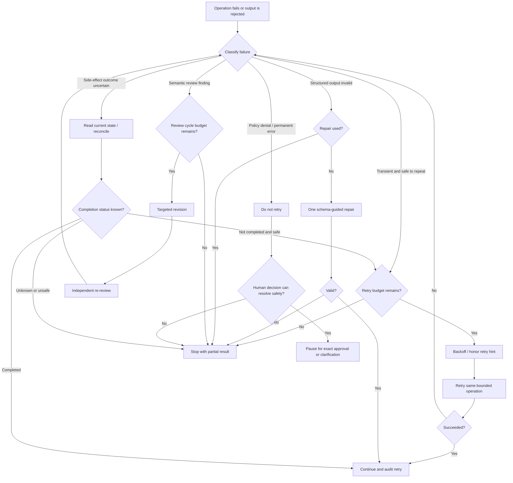

# Retry, Recovery, and Escalation Policy

## 1. Principles

Retries are a reliability mechanism, not a way to force a workflow to succeed. Every retry must have a classified cause, a safety check, an attempt budget, and an observable outcome.

Do not retry merely because the model is dissatisfied with an answer. Do not retry a permanent failure. Never blindly replay a side effect whose outcome is uncertain.

## 2. Failure classes

| Class | Examples | Default response |
|---|---|---|
| Transient infrastructure | Temporary tool outage, rate limit with retry hint, transient network failure on an approved endpoint | Retry within budget using backoff; preserve run state |
| Permanent infrastructure/configuration | Missing binary, invalid credentials, wrong path, unsupported test command | Stop and report; do not repeat unchanged request |
| Structured-output failure | Missing required field, invalid schema, malformed artifact | One repair attempt with precise validation errors; then stop |
| Semantic quality finding | Reviewer identifies missing boundary, unclear expected result, weak assertion | Route to the responsible agent for a bounded revision |
| Test failure caused by implementation | Assertion fails or test exposes a likely product defect | Diagnose once; do not change production code without approval |
| Environment-dependent test failure | Missing service, unavailable fixture, local environment mismatch | Classify as blocked/environmental; do not label as product defect or silently skip |
| Suspected flaky test | Same test produces inconsistent outcomes | One diagnostic rerun; if inconsistent, report flaky and preserve both results |
| Authorization/policy denial | Out-of-scope path/tool/action | Do not retry with alternate tools or broadened permissions; request approval or stop |
| Unknown outcome after side effect | Write/command may have completed but response was lost | Reconcile state before any retry; use idempotency where available |

## 3. Retry budgets

Initial defaults:

| Operation | Budget | Notes |
|---|---:|---|
| Transient read-only tool call | Initial attempt + 2 retries | Exponential backoff with jitter; obey server retry hints |
| Transient test-runner launch failure | Initial attempt + 2 retries | Retry only when failure is clearly infrastructure/launch related, not when a test assertion fails |
| Invalid structured artifact | 1 repair attempt | Supply schema errors; do not restart the entire workflow |
| Test-plan review/revision | Maximum 2 revision cycles | A review cycle means reviewer findings followed by an analyst/orchestrator revision and another review |
| Implementation correction/re-review | Maximum 2 correction cycles | Corrections must address specific findings; no broad rewrite loop |
| Flaky-test diagnosis | 1 additional run | Inconsistent results remain classified as flaky, not passing |
| Human approval wait | Runtime-defined deadline | On timeout, fail closed and preserve a resumable/blocked state |

A retry budget is separate from the total workflow budget. The Orchestrator must also cap total agent invocations, tool calls, execution time, and cost according to the environment.

## 4. Backoff

For transient infrastructure failures, use exponential backoff with jitter, for example:

`delay = random(0, min(cap, base * 2^attempt))`

A reasonable starting configuration is a 1-second base delay and a 10-second cap, subject to tool/provider retry instructions. Do not add unnecessary delays for local deterministic validation errors.

Respect `Retry-After` or equivalent provider guidance when available. Apply an overall deadline so repeated waiting cannot consume the entire run.

## 5. Idempotency and uncertain outcomes

Before retrying a write or other side-effecting action:

1. Determine whether the action is idempotent.
2. Determine whether the tool may have completed the action even though its response was lost.
3. Inspect the current state or query an operation status using a read-only mechanism.
4. Use a stable operation/run identifier or idempotency key where supported.
5. Retry only if evidence shows the action did not complete or the action is safely repeatable.

Never use retries to duplicate file creation, append operations, external requests, or destructive commands with uncertain outcomes.

## 6. Semantic review loops

### Planning loop

- Reviewer returns findings with severity, evidence, affected test case, and recommended change.
- Orchestrator determines whether each finding is valid and in scope.
- Analyst revises only affected portions and records what changed.
- Reviewer checks the revision.
- Stop after two revision cycles. Any unresolved P0/P1 finding becomes a human decision point; lower-priority residual findings are reported.

### Implementation loop

- Reviewer identifies a concrete defect in the test code or a mismatch against the plan.
- Engineer makes a minimal targeted correction.
- Relevant tests are rerun.
- Reviewer validates the correction.
- Stop after two correction cycles. Do not allow repeated full rewrites.

## 7. Failure handling state machine

## 8. Stop conditions

Stop the current workflow and return a partial report when:

- a hard permission boundary is hit;
- a permanent environment/configuration error blocks progress;
- a retry or review budget is exhausted;
- required behavior cannot be grounded in authoritative evidence;
- the current state of a side effect cannot be determined safely;
- the workflow exceeds its time, token, tool-call, or cost budget;
- the agent output fails validation after its repair allowance;
- a high-risk reviewer finding remains unresolved.

A stopped workflow must preserve completed artifacts and clearly state which stages did and did not complete.

## 9. Escalation payload

When escalating to a human, include:

- run and stage identifiers;
- concise description of the blocker;
- failure classification and evidence;
- attempted actions and retry counts;
- current state and uncertainty;
- available safe options and their trade-offs;
- exact decision required from the human.

Do not ask a vague question such as "Should I continue?" when the actual decision can be stated precisely.
